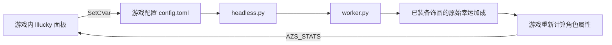

# lllucky

《艾泽拉斯幸存者》（Azeroth Survivors）的游戏内幸运饰品控制面板。

在游戏中输入 `/lllucky` 打开面板，设置每件幸运饰品的加成。实际修改由随游戏运行的无窗口 Python 组件完成，不需要独立控制窗口。

## 功能

- 游戏内开关、百分比输入、快捷档位、小地图按钮。
- 支持 **天选者印记**（Mark of the Chosen）和 **原始的附魔南海海带**（Pristine Enchanted South Seas Kelp）。
- 默认每件 **300%**；同时装备两件时叠加。已有设置会保留。
- 快捷档位：300%、1000%、10000%、1000000%；可输入 0–1000000%。
- 关闭开关时恢复本次接管前的加成。隐藏面板会保留当前效果。
- 显示游戏 `AZS_STATS` 报告的实际总幸运；不伪造显示值。
- 只调整项链的幸运效果，保留金币加成。
- 自动寻找游戏和装备；通过装备归属、数据结构、进程启动时间等检查后才写入。
- 后台随游戏退出；插件停止发送心跳约 20 秒后关闭效果并尝试恢复原值。

**这不是纯 Lua 数值修改插件。** Lua 面板负责保存配置和显示属性，Python 组件负责修改当前游戏进程内已装备饰品的加成。仅复制 AddOns 文件夹不会产生实际修改效果。

## 环境

- Windows 64 位。
- 64 位 Python 3.10 或更新版本；运行组件仅使用 Python 标准库，不需要 tkinter 或第三方包。
- Windows 原生版 Azeroth Survivors，安装目录中包含 `AzerothSurvivors.exe`。
- 游戏需提供 `RegisterCVar`、`GetCVar`、`SetCVar` 及 `AZS_STATS`。

当前实现根据 2026-10-28 本机运行版本的数据布局开发。游戏升级后若改变布局，可能需要适配；未通过检查的对象不会写入。

## 安装

先退出游戏，在 PowerShell 中运行：

```powershell
powershell -ExecutionPolicy Bypass -File .\scripts\install.ps1 `
  -GameDir "F:\AzerothSurvivors" `
  -PythonwPath "C:\Path\To\Python\pythonw.exe"
```

将路径替换为自己的安装位置。若 `pythonw.exe` 已在 PATH 中，可省略 `-PythonwPath`。

安装后会得到：

```text
AzerothSurvivors/
├─ Start-Azeroth-lllucky.cmd
├─ benilla-config/AddOns/lllucky/
│  ├─ lllucky.toc
│  └─ lllucky.lua
└─ Mods/lllucky/
   ├─ headless.py
   ├─ worker.py
   └─ memory_backend.py
```

使用 **`Start-Azeroth-lllucky.cmd`** 启动。若已有 `Start-Azeroth-Vulkan.cmd`，新启动器会调用它，保留显卡、Vulkan 和存档位置等设置；否则直接启动游戏。

在游戏的 AddOns 列表启用 `lllucky`。完整启动后输入 `/lllucky`。直接运行游戏 EXE 不会自动启动后台组件。

`-WhatIf` 可预览安装操作；安装脚本不复制游戏数据、修改存档或上传任何内容。

## 使用

1. 开一局并获得天选者印记或原始的附魔南海海带。
2. 输入 `/lllucky`，或点击小地图的饰品图标。
3. 勾选“启用幸运调整”，输入每件加成百分比，点击“应用”。
4. 查看面板的“游戏实际总幸运”，确认实际属性已变化。

其他幸运来源会继续叠加，因此总幸运可能高于设置值。首次全量寻找装备实测约 1–2 分钟；识别并缓存当前局后连接更快。设置通常约 1–2 秒同步。

| 命令 | 作用 |
| --- | --- |
| `/lllucky` | 显示或隐藏面板 |
| `/luck` | 面板命令别名 |
| `/lllucky on` | 开启调整 |
| `/lllucky off` | 关闭并恢复原加成 |
| `/lllucky 1000` | 将每件加成设为 1000% |

关闭面板只是隐藏 UI。要关闭效果，请取消勾选或输入 `/lllucky off`。

## 工作方式



面板使用以下自定义 CVar：

| 名称 | 内容 |
| --- | --- |
| `llluckySchema` | 配置协议版本，目前为 `1` |
| `llluckyEnabled` | `1` 为开启，`0` 为关闭 |
| `llluckyPercent` | 每件加成百分比 |
| `llluckyBeat` | 面板约每 4 秒发送的心跳 |

游戏自己保存配置；后台只读取配置，不重写其他游戏设置。恢复记录绑定当前进程启动时间，避免误用其他进程或旧会话的地址。

## 验证范围与限制

- 天选者印记已在实际游戏中验证开启、关闭、恢复原值及升级后保持。
- 游戏内面板 → 自定义 CVar → 无窗口后台 → 实际属性的通道已在本机验证。
- 1000%、10000%、100000%、1000000% 已完成实际属性写入与回读；**1000000% 不是已确定的游戏硬上限**。
- 未对超高幸运的实际抽卡概率做统计验证，不能据此宣称必出某种品质。
- 项链的效果布局已与游戏数据核对；叠加、恢复及保留金币已通过模拟内存测试，实际装备项链后的验证仍待补充。
- 不会生成饰品；没有装备受支持的饰品时会等待。
- 若饰品被替换，组件不会向已失去归属的旧对象恢复数据。
- 本工具针对本地游戏进程；没有联机同步、账号或网络服务。

## 开发与测试

```powershell
python -m unittest discover -s backend -p "test_*.py" -v
python -m py_compile backend\memory_backend.py backend\worker.py backend\headless.py
```

测试不需要运行游戏，覆盖：开关恢复、保留其他幸运来源、属性重算、饰品替换、旧会话隔离、项链与印记叠加、金币保留、配置解析及心跳超时。

从源码目录调试时可指定游戏位置：

```powershell
$env:LLLUCKY_GAME_DIR = "F:\AzerothSurvivors"
python .\backend\headless.py
```

已安装组件的默认路径按 `游戏目录/Mods/lllucky/` 推导。`LLLUCKY_GAME_DIR` 可覆盖此路径。

### 目录

```text
addon/lllucky/       游戏内面板与 TOC
backend/            无窗口后台、内存操作、测试
scripts/install.ps1 可移植安装脚本
```

运行时产生 `runtime-state.json`、`headless-state.json`、`headless.pid` 和日志。这些文件含本机会话信息，已在 `.gitignore` 中排除；不要提交它们。

## 常见问题

**有面板但数值没变化？**

确认从配套启动器进入游戏、本局已装备受支持饰品、开关已开启。首次查找需要等待；可查看组件目录下的 `headless-state.json` 和 `lllucky.log`。

**总幸运还是 0%？**

设置值只作用于已装备的幸运饰品。开局尚未取得饰品时，显示 0% 是正常的。

**升级后又回到原数值？**

当前实现修改饰品提供的加成。若仍发生回退，请记录游戏版本、装备名称、设置值和状态日志，检查更新后是否发生结构变化。

**怎么停用或移除？**

先在游戏中关闭开关并确认原值恢复，再退出游戏。删除 `benilla-config/AddOns/lllucky` 和 `Mods/lllucky`，以后使用原来的游戏启动器即可。

## 项目边界

本仓库只包含面板和配套控制代码，不包含游戏程序、美术、MPQ 数据、存档或第三方插件源码。它是独立的本地工具，与游戏作者及 Blizzard 无隶属关系。
